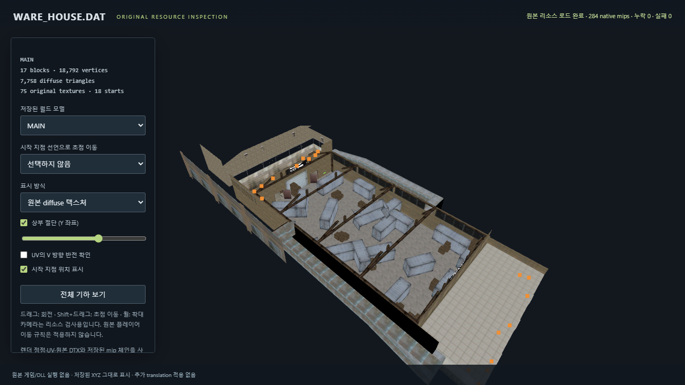
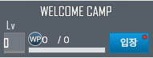

# 서든어택 로컬 재현 작업 공간

목표는 **현재 설치된 버전의 서든어택 클라이언트를 원본 근거에 따라 재현하는 것**이다.
바이너리·패키지 분석으로 확인한 코드와 리소스를 독립 구현으로 옮긴다.
현재는 실제 웨어하우스 렌더 메쉬·UV·텍스처를 표시하고, 설정·명중 표시·모델 스킬 비트의 확인된 부분을 재생할 수 있다.
원본 게임 전체와 동등한 플레이 가능 클라이언트는 아직 완성되지 않았다.
진행 근거와 미해결 항목은 [INVESTIGATION.md](INVESTIGATION.md)에 정리했다.

## 원본 웨어하우스 리소스 보기

`launch-world-viewer.cmd`를 실행하거나 다음 명령을 사용한다.

```powershell
python -m client_core.world_viewer
```

원본 `ware_house.dat`에서 복원한 렌더 정점 19,332개, 삼각형 10,599개, 23개 저장 월드와
원본 DTX 75개를 사용한다. 기본 MAIN 화면은 별도 lightmap pass의 중복 기하를 제외한 diffuse 삼각형 7,758개를 그린다.
시작 지점 선언 18개와 저장 월드 모델을 선택해서 확인할 수 있다.

드래그로 회전하고 Shift+드래그로 초점을 이동하며 휠로 확대한다.
위쪽 구조에 가려진 내부를 보려면 Y 좌표 절단을 사용한다. 원본 diffuse, 저장 정점 색상, 법선, 삼각형 경계를 비교할 수 있다.
추가 Python 패키지나 Tcl이 필요하지 않으며 서버는 `127.0.0.1`의 임의 포트에서 읽기 전용으로 실행된다.
서버 종료는 실행 창의 Ctrl+C다.

이 화면은 **원본 리소스 검증용 뷰어**다. 원본 플레이어 이동·셰이더 합성·조명·동적 모델 변환을 모두 구현한 화면으로 해석하지 않는다.
파일 바이트·경계·인덱스 검증은 [맵 형식 조사](spec/world-format-notes.md),
렌더 구조와 비교 출처는 `spec/world-render-notes.md`에 기록한다.



별도로 남아 있는 `practice*` 파일은 요청을 잘못 해석해 만들었던 임의 연습 게임이다.
원본 복원 성과에 포함하지 않으며 개발을 중단했다. 내역은 [당시 규칙](spec/practice-rules.md)에 구분해 보존했다.

## UI 보기

명중 표시 효과 미리보기는 `launch-hitmarker-preview.cmd` 또는 다음 명령으로 연다.

```powershell
python -m client_core.hitmarker_preview
```

스타일을 선택하고 클릭 또는 1/2/3 키로 일반 명중·헤드샷·처치를 시연한다.
원본 선언의 색상·길이·페이드 시간을 사용한다. Tk의 회전 다각형과 단색 배경 합성으로 표시하며,
원본 렌더러의 픽셀 일치는 검증하지 않았다. 사운드는 요청만 기록하고 재생하지 않는다.
이번 환경에서는 Tcl 초기화 오류로 실제 창 검증을 완료하지 못했다.

`launch-preview.cmd`를 실행하거나 다음 명령을 사용한다.

```powershell
python -m client_core.preview
```

오른쪽 위 목록에서 복원한 UI 13개를 선택한다. 아틀라스에서 자른 이미지 88개를 사용한다.
클릭은 요소 확인용이며 게임 동작을 실행하지 않는다. 프로젝트 안의 자료만 사용한다.



## 설정 재생

```powershell
python -m client_core --output my-config.json
```

출력 파일은 새 경로여야 한다. 선택적으로 `--display C:\Nexon\SuddenAttack\display.cfg`를 붙일 수 있다.
변수 처리 후 명령 선언을 처리하는 두 패스, 기본 명령 356개, 액션 119개, 바인딩 51개를 반영한다.
네이티브 콜백과 실제 게임 입력 처리는 아직 구현하지 않았다.

## 리소스 찾기

```powershell
python tools\catalog.py search evidence\assets.sqlite CShell
python tools\catalog.py search evidence\assets.sqlite crosshair --limit 20
```

목록은 패키지 320개, 항목 295,705개다. 선택 추출의 검증 결과는 `extracted/*/extraction-manifest.json`에 있다.
`spec/game-data-v2.sqlite`는 무기·배치·미션 등의 선언 DB다. 현재 실행 경로에서 사용되는지는 별도 검증이 필요하다.

## 도구

- `tools/package_header.py`: 관찰한 패키지 헤더 프로파일 읽기와 체크섬 검사.
- `tools/package_index.py`: 인덱스 복호화 및 항목 체크섬 검사.
- `tools/package_extract.py`: 지원하는 멤버의 크기·MD5 검사와 파일 저장. 모듈은 실행하지 않는다.
- `tools/engine_rez.py`: 이 설치본의 `engine.rez`에서 관찰한 디렉터리 구조 읽기.
- `tools/dtx_preview.py`: 관찰한 DTX의 원시 BGRA/BC 이미지를 PNG로 읽기.
- `tools/build_ui_preview.py`: XML과 아틀라스에서 UI 미리보기 자료 생성.
- `tools/rea_session.py`: REA MCP 세션 유지 및 호출 응답 보존.

출력·추출 도구는 기본적으로 새 경로만 받는다. 일부 암호·블록·추가 헤더 프로파일은 지원하지 않는다.
BC 디코딩은 [Microsoft의 블록 압축 명세](https://learn.microsoft.com/en-us/windows/win32/direct3d10/d3d10-graphics-programming-guide-resources-block-compression)를 참고했다.
DTX 헤더와 형식 번호 해석은 이 설치본에서 관찰한 재구성 결과다.

## 검사

```powershell
python -m unittest discover -s tools -p "test_*.py" -v
python -m unittest client_core.test_config -v
python -m unittest client_core.test_hitmarker -v
python -m unittest client_core.test_practice -v
python -m client_core.hitmarker_preview --smoke
python -m client_core.preview --smoke
```

패키지 통합 검사는 로컬 `global_00000.pkg`를 읽으며 원본을 수정하지 않는다.
검사는 구현 범위의 검증이며 원본 게임 전체와의 동등성을 보장하지 않는다.
